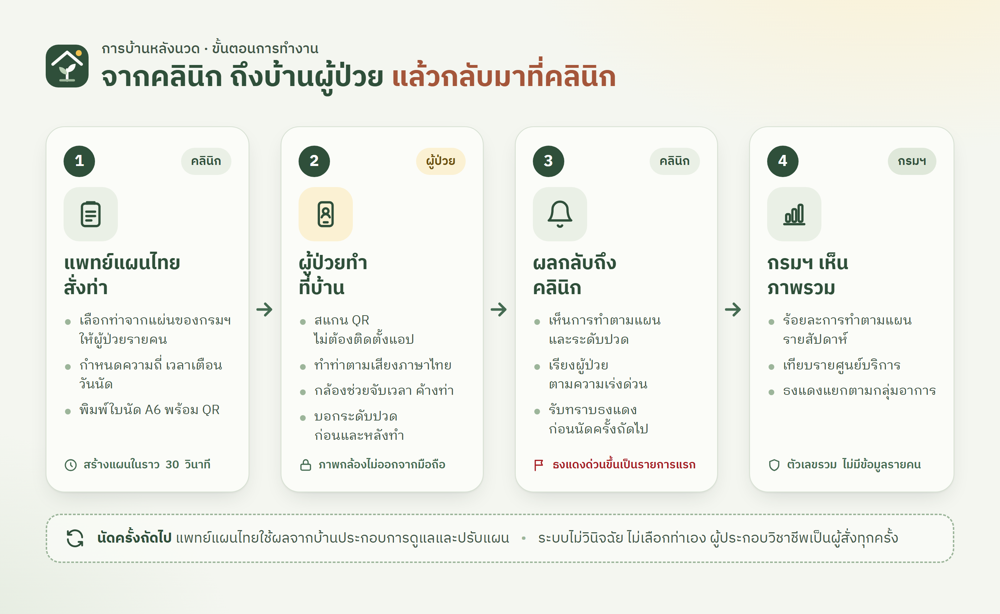

<div align="center">


# การบ้านหลังนวด

**TTM Home Program** · ระบบติดตามการทำท่าฤๅษีดัดตนที่บ้านหลังรับบริการนวดไทย

ผลงานต้นแบบ Thai Traditional Medicine Digital Health & AI Hackathon 2026 · Track 4 นวดไทยและเวลเนส

**[เปิดระบบสาธิต](https://ttm-home-program.vercel.app)** · [หน้าคลินิก](https://ttm-home-program.vercel.app/clinic) · [หน้ากรมฯ](https://ttm-home-program.vercel.app/dtam)

</div>

---

## ปัญหาที่แก้

แพทย์แผนไทยให้ท่าฤๅษีดัดตนไปทำต่อที่บ้านหลังนวด แต่ไม่มีใครรู้ว่าผู้ป่วยทำจริงหรือไม่ และไม่มีข้อมูลกลับมาถึงคลินิกก่อนนัดครั้งถัดไป

## ขั้นตอนการทำงาน



| ขั้น | ผู้ใช้ | สิ่งที่เกิดขึ้น |
|:---:|---|---|
| 1 | คลินิก | แพทย์แผนไทยเลือกท่าจากแผ่นของกรมฯ ให้ผู้ป่วยรายคน แล้วพิมพ์ใบนัด A6 พร้อม QR |
| 2 | ผู้ป่วย | สแกน QR (ไม่ต้องติดตั้งแอป) ทำท่าตามเสียงภาษาไทย กล้องช่วยจับเวลาค้างท่า และบอกระดับปวด |
| 3 | คลินิก | เห็นการทำตามแผน ระดับปวด และธงแดง ก่อนผู้ป่วยมาตามนัด |
| 4 | กรมฯ | เห็นร้อยละการทำตามแผนรวมทุกศูนย์ โดยไม่มีข้อมูลรายบุคคล |

> ระบบทำหน้าที่ส่งต่อคำสั่งของผู้ประกอบวิชาชีพเท่านั้น ไม่วินิจฉัยโรค ไม่เลือกท่าแทน และไม่ประเมินว่าท่าถูกหรือผิด

## ทดลองใช้ระบบสาธิต

| หน้า | วิธีเข้า | ลองทำอะไร |
|---|---|---|
| [`/clinic`](https://ttm-home-program.vercel.app/clinic) | กด **"เข้าคลินิกทดลอง"** ไม่ต้องใช้รหัส | ดูรายการผู้ป่วย กด **"สร้างแผน"** แล้วพิมพ์ใบนัดพร้อม QR |
| `/p/{รหัสแผน}` | สแกน QR บนใบนัดด้วยมือถือ | ให้ความยินยอม แล้วทำท่าพร้อมกล้อง |
| [`/dtam`](https://ttm-home-program.vercel.app/dtam) | เปิดได้ทันที | ดูภาพรวมรายสัปดาห์ เทียบรายศูนย์ และธงแดงตามกลุ่มอาการ |

ข้อมูลในระบบสาธิตเป็น**ข้อมูลจำลอง**ทั้งหมด (ศูนย์สาธิต 3 แห่ง ประมาณ 60 แผน ย้อนหลัง 8 สัปดาห์)

## ธงแดง 4 ระดับ

ผู้ป่วยตอบคำถามคัดกรองก่อนและหลังทำท่า และกดหยุดได้ตลอดเวลาระหว่างทำ ระบบใช้กฎตายตัว 16 ข้อพร้อมแหล่งอ้างอิง

| ระดับ | ผู้ป่วยเห็น | คลินิกเห็น |
|---|---|---|
| 🔴 โทร 1669 | จอแดงพร้อมปุ่มโทร 1669 ทันที | ขึ้นเป็นรายการแรก |
| 🟠 หยุดและติดต่อคลินิก | หยุดทำวันนี้ พร้อมเบอร์โทรคลินิก | ขึ้นเป็นรายการแรก |
| 🟡 พักท่านี้ | ข้ามท่านั้น ทำท่าอื่นต่อได้ | อยู่ในกลุ่มเฝ้าดู |
| ⚪ บันทึกไว้ | ตึงเมื่อยเล็กน้อยเป็นเรื่องปกติ | เป็นหมายเหตุสำหรับนัดครั้งถัดไป |

ระดับ 🔴 และ 🟠 คลินิกปิดไม่ได้ ส่วนระดับ 🟡 และ ⚪ คลินิกปรับเกณฑ์ได้

## การใช้ปัญญาประดิษฐ์ (AI)

| จุดที่ใช้ | เทคโนโลยี | ทำงานอย่างไร | ข้อมูลไปไหน |
|---|---|---|---|
| จับเวลาค้างท่า | MediaPipe Pose<br>(โมเดลเปิด ทำงานในเบราว์เซอร์) | ภาพกล้อง → จุดข้อต่อ 33 จุด → กฎเรขาคณิตของแต่ละท่า → "อยู่ในท่า" และตัวจับเวลา | อยู่ในมือถือเท่านั้น ไม่บันทึกภาพ |
| เสียงอ่านภาษาไทย | Gemini TTS<br>(สร้างไว้ล่วงหน้า) | ข้อความจากแผ่นท่าของกรมฯ → ไฟล์เสียง | ใช้เฉพาะข้อความของกรมฯ |
| ธงแดง | กฎตายตัว (ไม่ใช้ AI) | คำตอบคัดกรองและระดับปวด → กฎ 16 ข้อ → ระดับการตอบสนอง | ประเมินทั้งในมือถือและที่เซิร์ฟเวอร์ |

## ความปลอดภัยและข้อมูลส่วนบุคคล

- ✅ ใช้รหัสแผนเท่านั้น **ไม่เก็บ**ชื่อ เลขประจำตัวประชาชน HN หรือเบอร์โทรศัพท์
- ✅ ภาพจากกล้องประมวลผลในมือถือ ไม่ถูกบันทึกหรือส่งออก
- ✅ รหัสลับของแผนอยู่หลัง `#` ในลิงก์ เซิร์ฟเวอร์เก็บเฉพาะค่า SHA-256
- ✅ ขอความยินยอมก่อนใช้งาน และแจ้งว่าข้อมูลเก็บที่สิงคโปร์
- ✅ ลบข้อมูลเมื่อปิดแผนครบ 90 วัน และผู้ป่วยลบข้อมูลของตนเองได้ทุกเมื่อ
- ✅ กรมฯ เห็นเฉพาะตัวเลขรวม และศูนย์ที่มีน้อยกว่า 5 แผนจะไม่แสดงตัวเลข

## เทคโนโลยี

| ส่วน | ใช้ |
|---|---|
| เว็บแอป | Next.js 16 (App Router), React 19, TypeScript, Tailwind CSS 4 |
| ฐานข้อมูล | Supabase (PostgreSQL) ภูมิภาคสิงคโปร์ |
| กล้อง | MediaPipe Tasks Vision (Pose Landmarker) |
| ความปลอดภัย | zod (ตรวจข้อมูลเข้า), jose (cookie ที่ลงลายเซ็น), scrypt (PIN) |
| การทดสอบ | Vitest 185 กรณีทดสอบ |
| การติดตั้ง | Vercel ภูมิภาคสิงคโปร์ (`sin1`) |

## ที่มาของเนื้อหา

- **ท่าและภาพ:** แผ่น "ยืดเหยียด...ดัดตน...พ้นโรค ด้วยท่าฤๅษีดัดตน" ของกรมการแพทย์แผนไทยและการแพทย์ทางเลือก พ.ศ. 2569 ชุดที่ 1 (ออฟฟิศซินโดรม) ชุดที่ 2 (หัวไหล่ติด) และชุดที่ 6 (เข่าเสื่อม) ทุกท่าแสดงที่มาและลิงก์ไปยังเอกสารต้นฉบับ
- **กฎธงแดง:** จัดทำโดยคณะผู้พัฒนาจากเอกสารของกรมฯ ได้แก่ แนวทางเวชปฏิบัติสำหรับหน่วยบริการปฐมภูมิ (CPG_PCU) และแนวทางเวชปฏิบัติการดูแลผู้ป่วยระยะกลางด้วยการแพทย์แผนไทย (พ.ศ. 2564) ทุกข้อระบุแหล่งอ้างอิงและเลขหน้า และอยู่ระหว่างการตรวจรับรองโดยผู้ประกอบวิชาชีพ

---

## สำหรับนักพัฒนา

<details>
<summary><b>ติดตั้งและรันบนเครื่อง</b></summary>

```bash
npm install
cp .env.example .env.local
npm run dev
```

กำหนดค่าใน `.env.local` ตามคำอธิบายในไฟล์ `.env.example` คำสั่ง `npm run dev` และ `npm run build` ดาวน์โหลดโมเดล MediaPipe ให้อัตโนมัติ

หากยังไม่กำหนดค่า Supabase ระบบจะใช้ที่เก็บข้อมูลในหน่วยความจำ (ข้อมูลหายเมื่อเริ่มระบบใหม่) กรณีรัน `npm run build && npx next start` โดยไม่มี Supabase ต้องกำหนด `ALLOW_MEMORY_STORE=1` เพิ่ม (ห้ามกำหนดบน Vercel) สร้างข้อมูลจำลองได้ด้วย

```bash
curl -X POST http://localhost:3000/api/demo/reset -H "content-type: application/json" -d "{\"token\":\"<DEMO_RESET_TOKEN>\"}"
```

</details>

<details>
<summary><b>คำสั่งทั้งหมด</b></summary>

| คำสั่ง | การทำงาน |
|---|---|
| `npm test` | รันชุดทดสอบทั้งหมด (Vitest) |
| `npm run typecheck` / `npm run lint` | ตรวจสอบชนิดข้อมูลและรูปแบบโค้ด |
| `npm run build` | สร้างระบบสำหรับใช้งานจริง |
| `npm run seed` | สร้างข้อมูลจำลองใน Supabase ครั้งแรก (ต้องกำหนด `DEMO_CLINIC_PIN`) |
| `npm run seed -- --refresh` | สร้างแผนจำลองใหม่ให้เป็นวันที่ปัจจุบัน โดยคงคลินิก PIN และแผนอื่นไว้ |
| `npm run seed -- --reset` | ล้างฐานข้อมูลแล้วสร้างใหม่ (ไม่ดำเนินการหากยังมีแผนที่ป้องกันไว้ใน `PROTECTED_PLAN_CODES` เว้นแต่ระบุ `--wipe-everything`) |
| `npm run tts -- --sample` | สร้างไฟล์เสียงตัวอย่าง 3 ไฟล์ จากนั้นใช้ `npm run tts` สร้างไฟล์ที่เหลือ |
| `npm run images` | สร้างภาพแผ่นท่า `public/postures/*.webp` จากไฟล์ต้นฉบับ |
| `npm run purge` | ลบข้อมูลของแผนที่ปิดครบ 90 วัน |

</details>

<details>
<summary><b>ตั้งค่า Supabase และ Vercel</b></summary>

1. สร้างโปรเจกต์ Supabase ในภูมิภาคสิงคโปร์
2. เปิด SQL Editor วางเนื้อหาจาก `supabase/schema.sql` แล้วกด Run
3. คัดลอก Project URL และ service_role key จาก Settings → API ไปกำหนดใน `.env.local` และ Environment Variables ของ Vercel
4. ตรวจสอบว่า Functions ของ Vercel อยู่ที่ภูมิภาคสิงคโปร์ (`sin1`) ตามที่กำหนดใน `vercel.json`
5. สร้างข้อมูลจำลองด้วย `npm run seed` และก่อนนำเสนอใช้ `npm run seed -- --refresh` เพื่อปรับวันที่ให้เป็นปัจจุบัน

โปรเจกต์ Supabase แบบไม่มีค่าใช้จ่ายจะหยุดทำงานอัตโนมัติเมื่อไม่มีการใช้งานระยะหนึ่ง หากทุกหน้าที่ใช้ฐานข้อมูลแจ้งว่าระบบขัดข้อง ให้กด Restore project ในหน้า Supabase แล้วรอประมาณ 2–3 นาที

</details>

<details>
<summary><b>เอกสารประกอบ</b></summary>

- [เอกสารออกแบบระบบ](docs/superpowers/specs/2026-10-04-home-program-design.md)
- [แผนการพัฒนา](docs/superpowers/plans/2026-10-04-home-program.md)
- [แนวทางการออกแบบหน้าจอ](DESIGN.md)
- ต้นฉบับภาพขั้นตอนการทำงาน: [`docs/images/workflow.html`](docs/images/workflow.html)

</details>

---

<sub>ระบบนี้เป็นผลงานต้นแบบเพื่อการแข่งขัน ไม่ใช่เครื่องมือวินิจฉัยโรค</sub>
